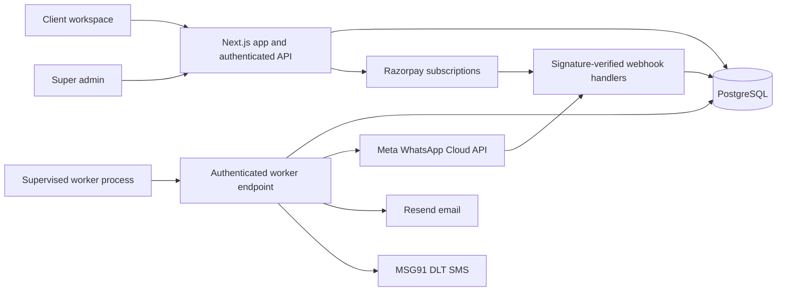

# Pulse Connect: SaaS architecture and operating model

This implementation replaces the single-account dashboard with a tenant-isolated application. It is a tested release candidate, not a certification of production readiness. No live provider credentials, payment activation, customer migration or public deployment were performed.

## Runtime

Use a managed PostgreSQL database with pooling, encrypted storage, point-in-time recovery and tested backups. Deploy the Node application behind HTTPS, a reverse proxy/WAF with request-size and request-rate limits, and a secret manager. Run `npm run worker` as a separate supervised service with the same APP_URL and WORKER_SECRET. Never expose the worker secret to the browser. Start with one worker and increase concurrency within provider limits after load tests. The current worker claims two messages per HTTP invocation and sleeps two seconds between invocations.

## Identity and ownership

- Account: globally unique email, salted scrypt password hash, operator-only super-admin flag.
- Workspace: organization, plan, subscription state, suspension flag.
- Membership: account + workspace, role owner/admin/member. Every data request resolves workspace membership from an opaque database session, never from an arbitrary client tenant header.
- Session: random 256-bit token in a Secure, HttpOnly, SameSite=Lax production cookie. Only its SHA-256 hash is stored; seven-day expiry; logout deletes it. Membership and suspension are checked on every API request.
- Mutation requests require the configured APP_URL origin. Database-backed rate limits protect authentication and workspace writes. The edge still needs an IP limit; the in-app authentication limit deliberately does not trust spoofable forwarding headers.
- Owner: billing, team management, connections and launches. Admin: team members, connections and launches. Member: contacts, suppression, templates and campaign drafts. Super admin: separate server-side permission for cross-workspace administration, channel/template verification and suspension. Public signup never grants super-admin rights.
- Provider credentials use AES-256-GCM with random nonces and are never returned by the read API. Back up ENCRYPTION_KEY securely; rotating it requires re-encrypting existing records and handling existing unsubscribe tokens.

Registration is closed by default. Enable ALLOW_SIGNUP only for controlled onboarding until email verification, recovery and MFA have been commissioned. A teammate registers first, is added by their organization owner and switches using the workspace ID. Owners can revoke member/admin access; admins can revoke members. Automated invitations, role changes and self-service recovery are not implemented.

## Campaign lifecycle

1. Create channel-specific contacts with explicit consent evidence. Duplicate imports do not reset suppression or replace consent evidence.
2. Create a fixed-content template. Email templates are usable immediately once the sender is verified. WhatsApp/SMS templates require operator verification against actual provider records.
3. Create a draft and optional schedule. The schedule is stored in UTC; dashboard dates display IST. The form uses the browser's local timezone and labels that explicitly.
4. An owner/admin launches. A serializable transaction checks tenant ownership, active paid-through subscription, verified connection, approved template, opted-in recipients, and plan quota. It atomically snapshots messages, reserves allowance, and moves the campaign out of draft. There is a unique campaign/contact key; concurrent launches cannot create duplicate queue entries.
5. A PostgreSQL outbox worker claims rows with `FOR UPDATE SKIP LOCKED`. It rechecks consent, suspension, subscription validity and connection verification immediately before dispatch.
6. Successful send calls are recorded as **accepted**, never delivered. WhatsApp status callbacks advance monotonically to sent/delivered/read or failed. Campaign **processed** means all dispatch attempts were handled, not that all recipients received messages.
7. An expired processing lease or ambiguous provider failure becomes **unknown**. It is never automatically retried, because a provider may already have sent it. An operator reconciles against provider logs before creating any retry. Resend receives the delivery ID as its idempotency key.

The launch transaction supports up to 10,000 recipients per campaign. Overview pages intentionally show at most 500 recent contacts, 100 campaigns/templates and 30 audit events; these are labeled and are not total audience statistics. Server-side pagination/import jobs are required before larger audiences should be offered as a polished product feature.

## Billing

Proposed INR platform prices: Starter ₹999/month (10,000 dispatches, 2 seats), Growth ₹2,499 (50,000, 5 seats), Scale ₹6,999 (200,000, 15 seats). These are your proposed product prices, **not provider quotes**. Tax treatment and invoices need to be configured for your actual business. Create matching monthly INR Razorpay plans and place their IDs in the environment. Amounts at the provider use paise: 99,900 / 249,900 / 699,900 before your chosen tax configuration.

Clients use their own provider accounts and pay SMS/WhatsApp/email fees directly. This avoids a speculative ₹/message wallet and gives you a predictable software fee. If you later resell usage, build an immutable integer-paise ledger, reservations, settlements against actual provider usage, refunds and invoice reconciliation first. The old floating-point wallet is not used.

Checkout creates a hosted Razorpay subscription link. The browser cannot activate a plan. A signed webhook fetches canonical subscription status and maps the provider plan ID to the internal plan; it sets paid-through expiry from current_end. A pending creation marker prevents double subscription creation. If a network timeout leaves a pending marker, reconcile in Razorpay before clearing it; never blindly create another subscription. Webhook event IDs are persisted for deduplication. Test authorized, active, halted, cancelled, expired and renewal cases in Razorpay test mode before enabling production billing. Plan changes/cancellations currently require the operator in Razorpay, followed by the signed webhook.

Dispatch allowance counts recipients reserved at launch per UTC calendar month, including later suppressions/unknown attempts. It is a capacity allowance, not a money charge or a delivered-message count. A scheduled campaign reserves capacity when it is queued. The UI states these semantics. Do not market it as a rolling subscription-period usage ledger.

## India sender identity and channel setup

**SMS:** a saved contact name and a template name cannot change the sender on a handset. Branded domestic business SMS uses a registered header, entity, content template and applicable DLT/provider chain setup. Promotional traffic may use different header rules from service/transactional traffic; the provider must approve the correct route for the actual use case. MSG91 stores the mapping between its template ID and DLT template/header/entity. This app stores both template IDs and only sends to +91 mobile numbers via its SMS adapter. The operator must verify exact content and the mapping, not just check that IDs are nonempty. The provider sends its stored template, not the content preview in this app. Fixed-content templates only; parameterized templates are not supported yet.

**Telnyx:** a rented international/local numeric number is not a way to force an Indian organization name into the sender field. Telnyx documents international alphanumeric ID replacement in India. Its legacy unauthenticated SMS/webhook endpoints have been retired with HTTP 410; existing inbound SMS is not migrated into the new application. If your Telnyx inbound service must continue, keep the old deployment isolated until signed, tenant-routed inbound ingestion is implemented. Do not route your production inbound webhooks to the retired paths.

**WhatsApp:** use Meta Cloud API, a business account, approved display name, phone number ID, access token and approved marketing templates. A platform serving many businesses should onboard each client's business assets (eventually via Embedded Signup). The app supports manually connected client credentials today. Opt-in and provider quality/rate limits still apply. Add an opt-out instruction to your approved templates; signed inbound STOP/UNSUBSCRIBE/CANCEL events suppress future WhatsApp campaign sends. A full agent inbox and free-form replies are not implemented.

**Email:** connect a Resend key and verified sending domain. Configure SPF, DKIM and DMARC in DNS; use an organization sender name. Each message contains a signed unsubscribe link and List-Unsubscribe headers. GET shows confirmation rather than silently unsubscribing on email scanner visits; POST supports one-click unsubscribe. Delivery/bounce/complaint webhooks for Resend and delivery reports for MSG91 are not implemented, so those channels remain **accepted** after a successful provider call. Commission those webhooks and suppression behavior before commercial bulk email operation.

WhatsApp and email do not use telecom SMS DLT; that does not mean unrestricted marketing. Use documented consent, provider approvals and applicable privacy/marketing obligations. There is no implemented DLT bypass. Do not assume ₹5,000 registration or ₹7/message is a universal tariff; obtain written operator/provider quotes, including taxes, SMS segments, destination and route.

Primary references consulted 27 October 2026:

- [TRAI advice to senders](https://www.trai.gov.in/advice-to-senders)
- [Telnyx India SMS guidelines](https://support-v2.telnyx.com/en/articles/6674383-india-sms-guidelines)
- [WhatsApp Business Messaging Policy](https://whatsappbusiness.com/policy/)
- [Meta template message API](https://whatsapp.github.io/WhatsApp-Nodejs-SDK/api-reference/messages/template/)
- [MSG91 send SMS](https://docs.msg91.com/sms/send-sms)
- [MSG91 DLT mapping checklist](https://msg91.com/help/dlt-registration-in-india/dlt-debugging-checklist)
- [Resend idempotency](https://resend.com/changelog/idempotency-keys)
- [Razorpay signature verification](https://github.com/razorpay/razorpay-node/blob/master/documents/paymentVerfication.md)

## Launch gates and remaining work

Before accepting paying production clients:

- Configure real business/provider accounts, domain authentication, operator identity, support, legally reviewed terms/privacy policy, invoice/tax/refund settings and production secrets.
- Complete Meta app permissions, provider approval checks and test sends to consenting test recipients; verify WhatsApp delivery and opt-out webhooks. No live provider sends were made during development.
- Complete email bounce/complaint handling and SMS delivery callbacks; commission verified tenant-routed inbound SMS if required.
- Add verified-email onboarding, secure password recovery, operator MFA, automated invitation workflows, data export/deletion/retention jobs and a documented access review process.
- Run capacity tests for your advertised volume and provider limits, add per-provider/tenant dispatch throttling, fair queue scheduling and operational reconciliation tooling. Current worker deliberately prioritizes conservative dispatch over maximum throughput.
- Set up alerts for queue age, unknown sends, webhook failures, subscription mismatches, DB capacity and authentication errors; rehearse backup restore and key recovery.
- Validate Razorpay test-mode events and actual recurring-payment eligibility for your merchant account; confirm canonical status updates under concurrent/reordered delivery.
- Reconcile legacy data into explicitly owned workspaces with documented consent. Nothing is automatically assigned to a client.

Audit events are application-level records, not an immutable tamper-proof log. Authentication, worker and webhooks must be operated over HTTPS. A code build or a zero-advisory dependency audit does not establish legal compliance or production reliability.
